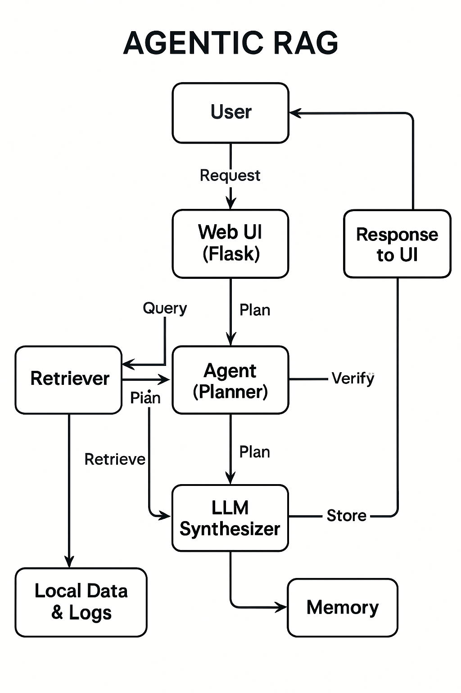

# Agentic RAG Invoice Matcher Project

## Overview
This project implements an **Agentic Retrieval-Augmented Generation (RAG)** system for explaining flagged invoices by matching invoices to purchase orders (POs), retrieving supporting evidence, verifying matches with confidence scores, and generating human-readable explanations using language models.  
It supports follow-up queries through short-term memory and maintains audit logs for transparency.

## Setup and Installation

1. Make sure Python 3.8+ is installed (recommended Python 3.8 or above).  
2. Clone this repository:  
   `git clone <your-repo-url>`  
3. Navigate to project directory:  
   `cd agentic_rag_project6th`  
4. Install required packages:  
pip install -r requirements.txt
5. Run the Flask web app locally:  
python app.py
6. Open your browser and go to:  
`http://127.0.0.1:5000/`

## Architecture Diagram

The system consists of these components:  
- **User Interface (Flask Web app):** For query input and response display.  
- **Agent (Planner):** Interprets user queries, plans next steps.  
- **Retriever:** Fetches invoices, purchase orders, and receipts data.  
- **Verifier:** Checks invoice to PO match scores and confidence.  
- **LLM Synthesizer:** Generates explainable text responses.  
- **Memory:** Maintains short-term context for follow-up queries.  
- **Audit Logger:** Tracks all system decisions and actions.

## Features Implemented

- Explanation of flagged invoices with evidence and match scores.  
- Follow-up query support (e.g., “Approve it”) via short-term memory.  
- Audit logging of planner and agent outputs for transparency.  
- Simple, intuitive web UI for interaction.

## Limitations

- Multi-agent pipeline and complex planning logic not implemented.  
- Only local data sources used; no integration with cloud or web search.  
- Verifier logic is heuristic and simplified.  
- No user authentication or production-ready deployment setup.

## Next Steps

- Extend planner to handle multiple agents and complex actions.  
- Integrate cloud-based data retrieval and web search.  
- Improve verifier with advanced ML models.  
- Add user roles, security, and scalable deployment.

## Usage

- Enter invoice-related queries in the input box, e.g.,  
“Why was invoice INV-123 flagged?”  
- View detailed explanations with evidence and match confidence.  
- Use follow-up queries like “Approve it” to simulate workflow continuation.  
- Review previous interactions in conversation history section.

---

For questions or help, please contact [your email or contact info].

